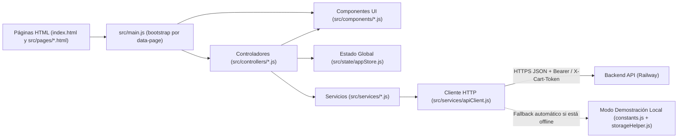

# Librería Estudio — Frontend

Aplicación web modular para **Librería Estudio**, una tienda en línea especializada en útiles escolares, papelería técnica y paquetes por grado educativo. Está construida con **HTML5 semántico**, **CSS3 con tokens de diseño oficiales** y **JavaScript ES6+ nativo (`type="module"`)**, sin frameworks pesados ni pasos de compilación (*build*).

> **Repositorio Backend relacionado:** [libreria-estudio-backend](https://github.com/ixenbrandonestiben-lang/libreria-estudio-backend) · **API en vivo (Railway):** https://libreria-estudio-backend-production.up.railway.app/api/v1/health

---

## Tabla de contenidos

- [Descripción del proyecto](#descripción-del-proyecto)
- [Arquitectura general](#arquitectura-general)
- [Estructura del repositorio](#estructura-del-repositorio)
- [Pantallas implementadas](#pantallas-implementadas)
- [Seguridad en cliente y compatibilidad anti-bloqueo](#seguridad-en-cliente-y-compatibilidad-anti-bloqueo)
- [Conexión con el Backend y modo demostración local](#conexión-con-el-backend-y-modo-demostración-local)
- [Instalación y ejecución local](#instalación-y-ejecución-local)
- [Despliegue en GitHub Pages](#despliegue-en-github-pages)
- [Verificación y pruebas](#verificación-y-pruebas)

---

## Descripción del proyecto

El frontend sigue una arquitectura **MPA modular (Multi-Page Application)** donde cada pantalla HTML declara su identificador en `<body data-page="...">` y carga un único punto de entrada (`src/main.js`). A partir de ese identificador, `main.js` monta los componentes globales (barra de navegación, pie de página, cajón del carrito, avisos de privacidad, widget de ayuda y notificaciones) e inicializa exclusivamente el controlador correspondiente a la vista actual.

Características principales:
- **Cero dependencias de runtime o build**: funciona directamente en cualquier servidor HTTP estático.
- **Estado reactivo centralizado**: `src/state/appStore.js` sincroniza sesión, carrito, reserva de inventario (15 minutos), filtros, direcciones, órdenes y consentimiento de privacidad con `localStorage`.
- **Resiliencia ante desconexión**: si la API backend no está disponible, `src/services/apiClient.js` y los servicios activan un **modo demostración local automático** para explorar el catálogo, el cotizador, el carrito y el panel administrativo sin interrupciones.
- **Accesibilidad y rendimiento**: diseño *mobile-first*, contraste WCAG, navegación por teclado (`:focus-visible`, `.skip-link`) y soporte para `prefers-reduced-motion`.

---

## Arquitectura general

El flujo de datos unidireccional separa claramente la presentación (HTML/CSS/Componentes), la coordinación de pantalla (Controladores), la lógica de comunicación (Servicios + `apiClient`) y el estado global (`appStore`).



> Para ver los diagramas de secuencia detallados (flujo de compra del cliente y flujo del administrador) y la guía del sistema visual, consulta [docs/frontend-architecture.md](docs/frontend-architecture.md).

---

## Estructura del repositorio

Árbol real de archivos y carpetas del proyecto:

```text
libreria-estudio-frontend/
├── .env.example                 # Plantilla de variables de referencia (puerto, API_BASE_URL, SITE_URL)
├── .eslintrc.json               # Reglas de estilo y calidad JavaScript
├── .prettierrc.json             # Formato estándar del proyecto
├── README.md                    # Documentación principal del frontend
├── index.html                   # Página de inicio (data-page="home")
├── package.json                 # Metadatos ES module ("type": "module") y scripts npm
├── docs/
│   └── frontend-architecture.md # Diagramas de secuencia y guía del sistema visual
├── public/
│   ├── manifest.json            # Manifiesto web de la aplicación
│   ├── robots.txt               # Reglas de rastreo para buscadores
│   └── sitemap.xml              # Mapa de URLs públicas
├── scripts/
│   └── verify.mjs               # Verificador automático de archivos, sintaxis, seguridad XSS y formato
├── tests/
│   └── frontend.test.mjs        # Suite de pruebas unitarias con node:test
└── src/
    ├── main.js                  # Punto de entrada: monta componentes globales y enruta al controlador
    ├── assets/
    │   ├── css/                 # Hojas de estilo modulares (variables, reset, base, layout, hero, components, pages)
    │   └── images/              # Favicon, ilustración hero e íconos SVG de productos (products/)
    ├── components/              # Componentes reutilizables construidos sin innerHTML
    │   ├── CartDrawer.js
    │   ├── CategoryGrid.js
    │   ├── FilterSidebar.js
    │   ├── Footer.js
    │   ├── HelpQuickWidget.js
    │   ├── HeroSection.js
    │   ├── Navbar.js
    │   ├── PaginationBar.js
    │   ├── PrivacyNoticeBanner.js
    │   ├── PrivacyPreferencesModal.js
    │   ├── ProductCard.js
    │   ├── ReservationTimer.js
    │   ├── SchoolListItemRow.js
    │   ├── SearchBar.js
    │   └── ToastNotification.js
    ├── controllers/             # Lógica de coordinación por cada pantalla (data-page)
    │   ├── accountController.js
    │   ├── adminController.js
    │   ├── authController.js
    │   ├── catalogController.js
    │   ├── checkoutController.js
    │   ├── helpController.js
    │   ├── homeController.js
    │   ├── legalController.js
    │   ├── productDetailController.js
    │   └── schoolListController.js
    ├── pages/                   # Vistas HTML secundarias (16 páginas)
    │   ├── account.html
    │   ├── admin.html
    │   ├── catalog.html
    │   ├── checkout.html
    │   ├── cookies-policy.html
    │   ├── forgot-password.html
    │   ├── help.html
    │   ├── list-builder.html
    │   ├── login.html
    │   ├── orders.html
    │   ├── privacy.html
    │   ├── product.html
    │   ├── register.html
    │   ├── reset-password.html
    │   ├── terms.html
    │   └── track-order.html
    ├── services/                # Comunicación con Backend API y fallback local
    │   ├── adminService.js
    │   ├── apiClient.js
    │   ├── authService.js
    │   ├── cartService.js
    │   ├── orderService.js
    │   ├── privacyConsentService.js
    │   ├── productService.js
    │   ├── schoolListService.js
    │   ├── supportService.js
    │   └── userService.js
    ├── state/
    │   └── appStore.js          # Store reactivo con persistencia en localStorage
    └── utils/                   # Utilidades transversales
        ├── constants.js         # API_BASE_URL, ROUTES, categorías, catálogo demo y FAQs
        ├── domSanitizer.js      # Construcción segura de DOM (createElement, escapeHtml, sanitizeUrl)
        ├── formatters.js        # Formato de moneda (MXN), fechas y textos
        ├── scrollObserver.js    # IntersectionObserver para animaciones .reveal
        ├── storageHelper.js     # Wrapper seguro sobre localStorage
        └── validators.js        # Validaciones de formularios y datos
```

### Responsabilidad de cada módulo en `src/`

| Carpeta / Archivo | Responsabilidad |
| :--- | :--- |
| `src/main.js` | Lee `document.body.dataset.page`, monta los 7 componentes globales (`Navbar`, `Footer`, `CartDrawer`, `PrivacyNoticeBanner`, `PrivacyPreferencesModal`, `HelpQuickWidget`, `ToastNotification`) e invoca el controlador de la página activa. |
| `src/pages/` | Contiene las 16 páginas HTML secundarias con estructura semántica (`<header>`, `<main>`, `<footer>`, `.skip-link`) y carga de los 7 archivos CSS en orden de cascada. |
| `src/components/` | Componentes de interfaz puros que reciben contenedores DOM, escuchan `appStore` cuando aplica y renderizan usando `domSanitizer.js`. |
| `src/controllers/` | Conectan los eventos del usuario en cada página con los servicios y actualizan el DOM y el estado global. |
| `src/services/` | Encapsulan las llamadas REST hacia la API mediante `apiRequest()` y proveen respuestas de respaldo en modo demostración local si hay fallo de red. |
| `src/state/` | `appStore.js` mantiene el estado de la aplicación (usuario, token, carrito, temporizador de reserva de 15 min, consentimiento, direcciones, órdenes, filtros y notificaciones toast). |
| `src/utils/` | Contiene configuración global (`constants.js`), sanitización XSS (`domSanitizer.js`), formateo (`formatters.js`), validadores (`validators.js`), almacenamiento (`storageHelper.js`) y animaciones al hacer scroll (`scrollObserver.js`). |
| `src/assets/css/` | Estilos organizados en capas: `variables.css` (tokens), `reset.css`, `base.css`, `layout.css`, `hero-scroll.css`, `components.css` y `pages.css`. |

---

## Pantallas implementadas

El sitio cuenta con **17 vistas HTML** (la portada `index.html` más 16 páginas en `src/pages/`):

| Pantalla | Archivo | `data-page` | Controlador | Descripción |
| :--- | :--- | :--- | :--- | :--- |
| **Inicio** | `index.html` | `home` | `homeController.js` | Hero principal, cuadrícula de categorías (`CategoryGrid`), productos destacados y acceso directo al Cotizador de Listas. |
| **Catálogo** | `src/pages/catalog.html` | `catalog` | `catalogController.js` | Buscador con debounce (`300 ms`), barra lateral de filtros (`FilterSidebar` por categoría, marca, nivel, precio y stock), ordenamiento y paginación (`PaginationBar`). |
| **Detalle de producto** | `src/pages/product.html` | `product` | `productDetailController.js` | Ficha técnica completa (SKU, marca, nivel educativo, especificaciones de gramaje/formato), disponibilidad y botón para agregar al carrito. |
| **Cotizador de Listas Escolares** | `src/pages/list-builder.html` | `list-builder` | `schoolListController.js` | Permite pegar una lista de útiles o cargar plantillas por grado (`primaria`, `secundaria`, `preparatoria`), ajustar cantidades/alternativas (`SchoolListItemRow`) y enviar todo al carrito en un clic. |
| **Checkout** | `src/pages/checkout.html` | `checkout` | `checkoutController.js` | Resumen del pedido, temporizador de reserva de stock (`ReservationTimer` de 15 minutos), selección o captura de dirección, opción de facturación y confirmación de orden. |
| **Autenticación** | `src/pages/login.html`, `register.html`, `forgot-password.html`, `reset-password.html` | `login`, `register`, `forgot-password`, `reset-password` | `authController.js` | Inicio de sesión, registro de clientes, solicitud de recuperación de contraseña y restablecimiento mediante token. |
| **Cuenta y Órdenes** | `src/pages/account.html`, `orders.html` | `account`, `orders` | `accountController.js` | Perfil del usuario autenticado, gestión de direcciones de envío e historial de pedidos con detalle de artículos y estado. |
| **Ayuda y Rastreo** | `src/pages/help.html`, `track-order.html` | `help`, `track-order` | `helpController.js` | Preguntas frecuentes (`FAQS`), formulario de tickets de soporte y consulta pública de estado de envío por número de orden (`LE-XXXX`). |
| **Páginas Legales** | `src/pages/terms.html`, `privacy.html`, `cookies-policy.html` | `terms`, `privacy`, `cookies-policy` | `legalController.js` | Términos y condiciones, aviso de privacidad y política de cookies con acceso al modal de preferencias. |
| **Panel de Administración** | `src/pages/admin.html` | `admin` | `adminController.js` | Panel restringido por rol `admin` (con botón **Vista Demo Admin** cuando el backend está offline) organizado en **5 módulos por pestañas**. |

### Los 5 módulos del Panel de Administración (`src/pages/admin.html`)

1. **Resumen y Ventas (`#panel-analytics`)**: tarjetas KPI de ingresos, órdenes, productos con bajo inventario y métricas generales.
2. **Productos e Inventario (`#panel-products`)**: formulario de alta de productos (SKU, título, marca, categoría, precio, stock, unidad de venta y empaque) y tabla para gestionar catálogo y existencias.
3. **Órdenes (`#panel-orders`)**: listado de pedidos con cambio de estado (`paid`, `processing`, `shipped`, `delivered`, `cancelled`, `refunded`).
4. **Tickets de Soporte (`#panel-tickets`)**: bandeja de solicitudes de clientes con actualización de estado (`open`, `in_progress`, `resolved`, `closed`).
5. **Usuarios y Roles (`#panel-users`)**: directorio de cuentas registradas con gestión de roles (`customer`, `admin`).

---

## Seguridad en cliente y compatibilidad anti-bloqueo

El proyecto aplica controles estrictos en cliente verificados automáticamente por `scripts/verify.mjs`:

1. **Prevención total de XSS (`src/utils/domSanitizer.js`)**:
   - **Prohibido el uso de `innerHTML`**: toda la interfaz se construye mediante `document.createElement` y `textContent` a través de `createElement()`, `setSafeText()` y `clearElement()`.
   - **Bloqueo de atributos peligrosos**: `createElement()` descarta automáticamente atributos `style` y cualquier manejador de eventos `on*` (`onclick`, `onload`, etc.).
   - **Sanitización de URLs**: `sanitizeUrl()` valida que los enlaces externos usen únicamente protocolos seguros (`http:`, `https:`, `mailto:`, `tel:`) o rutas relativas válidas, bloqueando `javascript:` o `data:text/html`.
   - **Sin estilos ni scripts inline en HTML**: los 17 archivos HTML carecen de atributos `style="..."` o `on*="..."`.

2. **Nombres neutrales contra bloqueadores de contenido**:
   - El aviso y modal de consentimiento de privacidad utilizan nombres de módulos y servicios neutrales (`PrivacyNoticeBanner.js`, `PrivacyPreferencesModal.js`, `privacyConsentService.js`) en lugar de nombres genéricos como `CookieBanner` o `adConsent`, evitando falsos positivos en extensiones y navegadores con escudos estrictos como **Brave Shields** o **uBlock Origin**.

---

## Conexión con el Backend y modo demostración local

La configuración de red se centraliza en `src/utils/constants.js`:

```js
export const API_BASE_URL =
  (typeof window !== 'undefined' && window.__API_BASE_URL__) ||
  'https://libreria-estudio-backend-production.up.railway.app/api/v1';
```

- **Producción**: apunta por defecto al backend desplegado en Railway (`https://libreria-estudio-backend-production.up.railway.app/api/v1`).
- **Sobrescritura en tiempo de ejecución**: si se define `window.__API_BASE_URL__` antes de cargar `src/main.js`, el cliente HTTP utilizará esa URL (útil para apuntar a un backend local como `http://localhost:3000/api/v1`).
- **Cliente HTTP (`src/services/apiClient.js`)**:
  - Timeout configurable (`REQUEST_TIMEOUT_MS = 10000`, 10 segundos) con `AbortController` y soporte para `AbortSignal` externo.
  - Envía automáticamente `Authorization: Bearer <token>` cuando existe sesión activa y `X-Cart-Token` para sincronizar carritos de invitados, además de `credentials: 'include'`.
  - Normaliza todas las respuestas al contrato `{ success, message, data, error }`.
- **Modo demostración local automático**: si `fetch` falla por red no disponible (`NETWORK_OFFLINE`), los servicios utilizan los datos de `DEMO_PRODUCTS`, `CATEGORIES`, `GRADE_TEMPLATES` y `FAQS` definidos en `src/utils/constants.js`, persistiendo carrito, órdenes y cambios de prueba en `localStorage` a través de `src/utils/storageHelper.js`.

---

## Instalación y ejecución local

### Requisitos previos

- **Python 3** (incluido en macOS/Linux) o la extensión **Live Server** de VS Code, o cualquier servidor HTTP estático.
- **Node.js `>= 20.x`** (únicamente para ejecutar el verificador `scripts/verify.mjs` y las pruebas unitarias).

> **Importante:** Al usar módulos ES6 nativos (`<script type="module">`), los navegadores bloquean las importaciones si abres `index.html` con doble clic (`file://`). Siempre debes servir el proyecto mediante HTTP.

### Opción 1: Servidor local con `npm run dev` (puerto `8080`)

```bash
# 1. Clonar o ubicarse en la raíz del repositorio
cd libreria-estudio-frontend

# 2. (Opcional) Revisar variables de referencia
cp .env.example .env

# 3. Iniciar el servidor HTTP estático en el puerto 8080 (usa python3 -m http.server 8080)
npm run dev
```

Abre en tu navegador: **`http://localhost:8080`**

### Opción 2: VS Code Live Server

1. Abre la carpeta `libreria-estudio-frontend` en Visual Studio Code.
2. Haz clic derecho sobre `index.html` y selecciona **Open with Live Server** (o usa el botón **Go Live** en la barra inferior).
3. Asegúrate de que el servidor apunte a la raíz del proyecto para que las rutas relativas de `getRootPrefix()` (`./` y `../../`) funcionen correctamente tanto en `index.html` como en `src/pages/*.html`.

---

## Despliegue en GitHub Pages

Al ser un sitio 100% estático sin paso de compilación:

1. Antes de publicar, actualiza el dominio de ejemplo en `public/robots.txt` y `public/sitemap.xml` con la URL final de tu sitio.
2. Sube el repositorio a GitHub.
3. Ve a **Settings → Pages** en tu repositorio de GitHub.
4. En **Build and deployment**, selecciona **Source: Deploy from a branch**, elige la rama principal (`main`) y la carpeta **`/ (root)`**.
5. Guarda los cambios. GitHub Pages publicará directamente `index.html` y resolverá de forma relativa todas las rutas de `src/pages/*.html` gracias a `getRootPrefix()` y `resolvePageUrl()` en `src/utils/constants.js`.

---

## Verificación y pruebas

El repositorio incluye un script de verificación estática (`scripts/verify.mjs`) y una suite de pruebas unitarias nativas con `node:test` (`tests/frontend.test.mjs`):

```bash
# Verificar sintaxis JS (node --check), reglas anti-XSS y formato
npm run lint
npm run format

# Verificación integral (presencia de archivos clave + lint + seguridad + formato)
npm run verificar

# Ejecutar pruebas unitarias con el test runner nativo de Node.js
node --test tests/*.test.mjs
```
