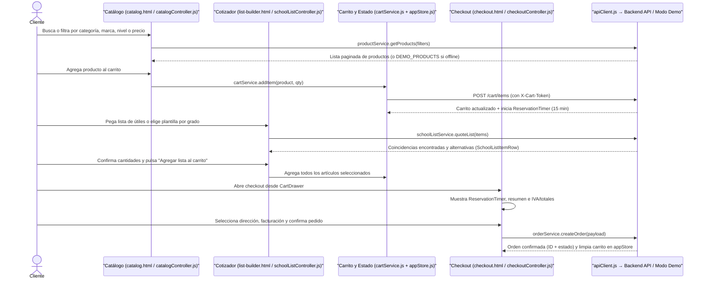
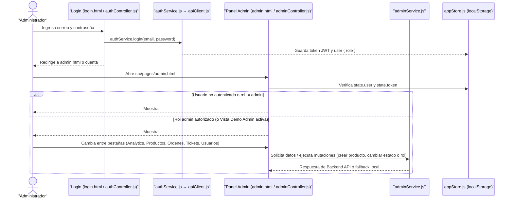

# Arquitectura del Frontend — Librería Estudio

Este documento complementa al [README principal](../README.md) detallando los flujos de interacción principales (cliente y administrador) y las especificaciones del sistema visual, diseño responsivo y accesibilidad.

---

## 1. Flujos principales de usuario

### 1.1 Recorrido del Cliente: Catálogo → Cotizador → Carrito → Checkout

El cliente puede descubrir productos desde el catálogo con filtros o armar su pedido a partir de una lista escolar completa, manteniendo sincronizado el carrito y una reserva temporal de inventario de **15 minutos** (`RESERVATION_MINUTES = 15`).

### 1.2 Recorrido del Administrador: Autenticación → Panel de Administración

El acceso a `src/pages/admin.html` valida el rol del usuario autenticado (`user.role === 'admin'`). Si el usuario no tiene permisos o no ha iniciado sesión, se muestra `#admin-restricted-view`; si el servidor backend está fuera de línea, se habilita el botón **Vista Demo Admin** (`#admin-demo-btn`) para evaluar los 5 módulos de gestión localmente.

---

## 2. Guía del sistema visual

Todos los tokens de diseño viven en `src/assets/css/variables.css` y se aplican en cascada a través de `reset.css`, `base.css`, `layout.css`, `hero-scroll.css`, `components.css` y `pages.css`.

### 2.1 Paleta oficial de colores

| Token CSS | Valor Hex | Uso principal |
| :--- | :--- | :--- |
| `--color-primary` | `#1E3A8A` | Color institucional, encabezados de énfasis, botones primarios y enlaces activos |
| `--color-primary-hover` | `#172E6E` | Estado hover/focus de elementos primarios |
| `--color-primary-soft` | `#EFF6FF` | Fondos suaves de tarjetas destacadas y badges informativos |
| `--color-secondary` | `#0D9488` | Acentos secundarios, indicadores de categorías y acciones complementarias |
| `--color-secondary-hover` | `#0F766E` | Estado hover de elementos secundarios |
| `--color-secondary-soft` | `#F0FDFA` | Superficies suaves de apoyo |
| `--color-accent` | `#F59E0B` | Llamados a la acción destacados (`.btn--accent`) y anillo de foco visible |
| `--color-accent-hover` | `#D97706` | Estado hover del acento |
| `--color-accent-soft` | `#FFFBEB` | Fondos suaves de avisos y alertas de acento |
| `--color-bg` | `#F8FAFC` | Fondo general de página |
| `--color-surface` | `#FFFFFF` | Fondo de tarjetas, modales, cajón del carrito y barra de navegación |
| `--color-text` | `#0F172A` | Texto principal de alto contraste |
| `--color-text-muted` | `#475569` | Texto secundario, descripciones y metadatos |
| `--color-border` | `#E2E8F0` | Bordes sutiles de tarjetas, tablas y divisores |
| `--color-success` / `--color-success-soft` | `#15803D` / `#DCFCE7` | Confirmaciones, stock disponible y órdenes entregadas |
| `--color-warning` / `--color-warning-soft` | `#B45309` / `#FEF3C7` | Stock bajo, temporizador por expirar y avisos preventivos |
| `--color-danger` / `--color-danger-soft` | `#B91C1C` / `#FEE2E2` | Errores de validación, cancelaciones y acciones destructivas |

### 2.2 Tipografía, espaciado y capas (`z-index`)

- **Tipografía**: pila nativa de sistema (`--font-sans`) para carga instantánea sin fuentes externas bloqueantes, y monoespaciada (`--font-mono`) para SKUs, códigos de orden y temporizadores. Los encabezados `h1` y `h2` usan `clamp()` en `src/assets/css/base.css` para escalar fluidamente.
- **Contenedor máximo**: `--container-max: 1240px` centrado con relleno lateral adaptable.
- **Capas (`z-index`)**: jerarquía ordenada desde `--z-header: 40`, `--z-dropdown: 50`, `--z-widget: 55`, `--z-banner: 60`, `--z-drawer: 70`, `--z-modal: 80` hasta `--z-toast: 90`.

### 2.3 Diseño responsivo *mobile-first*

Definido en `src/assets/css/layout.css` con *breakpoints* progresivos:

| Ancho de pantalla | Comportamiento de cuadrículas y layout |
| :--- | :--- |
| **Base (`< 640px`, móvil)** | `.grid--2`, `.grid--3` y `.grid--4` en 1 columna; `.grid--categories` en 2 columnas; `.catalog-layout` y `.two-col-layout` apilados en 1 columna. |
| **Tablet (`>= 640px`)** | `.grid--2`, `.grid--3` y `.grid--4` pasan a 2 columnas; `.grid--categories` pasa a 3 columnas; `.section__header--row` cambia a disposición horizontal. |
| **Escritorio (`>= 960px`)** | `.grid--3` en 3 columnas; `.grid--4` en 4 columnas; `.grid--categories` en 6 columnas; `.catalog-layout` en barra lateral fija + contenido (`280px 1fr`); `.two-col-layout` en proporción `1.5fr 1fr`. |

### 2.4 Accesibilidad (WCAG) y `prefers-reduced-motion`

- **Navegación por teclado**: todas las páginas incluyen `<a class="skip-link" href="#main-content">Saltar al contenido principal</a>` y un anillo de foco visible de alto contraste (`:focus-visible` con `outline: 3px solid var(--color-accent)`).
- **Semántica y ARIA**: uso de roles y atributos `aria-label`, `aria-labelledby`, `aria-current="page"`, `role="tablist"` / `role="tabpanel"` en `admin.html`, `role="status"` y `.sr-only` para lectores de pantalla.
- **Sensibilidad al movimiento (`src/assets/css/base.css`)**: mediante `@media (prefers-reduced-motion: reduce)`, se desactiva `scroll-behavior: smooth`, se reducen animaciones y transiciones a `0.01ms` y se muestran directamente los elementos `.reveal` sin desplazamiento.
